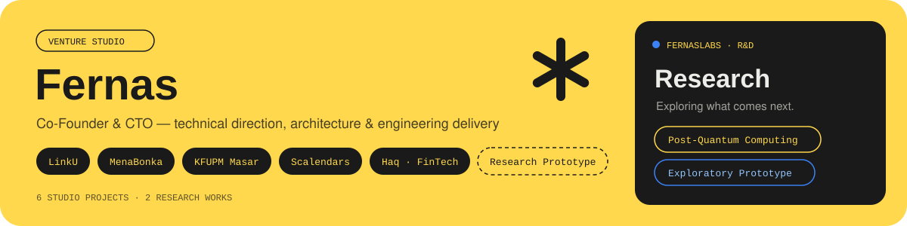

<h1>Hi 👋, I'm Thamer</h1>

<h3>Co-Founder &amp; CTO @ Fernas · Computer Science @ KFUPM</h3>

Building practical software with clean architectures — and technology that serves communities.

---

<h2 align="center">🚀 About Me</h2>

  

<h2 align="center">🧪 What I'm Building</h2>

  

<h2 align="center">🛠️ Featured Projects</h2>

| | Project | Highlights | Stack |
|:-:|:--|:--|:--|
| 🧭 | **Office Navigation Web App** HungerStation · Aug 2026 | Internal app that helps employees find rooms, images and room info — I focused on the backend. | `Node.js` |
| 🎟️ | **Full-Stack Event Booking Platform** CS50x Final Project · 2025 | User auth, SQL-backed event listings, a complete booking flow and an admin dashboard. | `Flask` `Python` `SQL` |
| 🧠 | **City Prediction AI Model** CS50AI Final Project · 2025 | Predicts a user's city from behavioral & demographic data using Bayesian inference and ML. | `Python` `AI` |
| 🎮 | **Online Games Platform & Community** Self-initiated · 2021 – 2023 | SQL-backed platforms powered by custom scripts; grew a community of 2,600+ members. | `SQL` `Lua` |

More details on my <a href="https://www.thameralmaqhawi.site">portfolio →</a>

<h2 align="center">🤝 Connect</h2>

  &nbsp;
  &nbsp;
  &nbsp;
  

<h2 align="center">💻 Tech Stack</h2>

  
   
  

  
  
  
  

<h2 align="center">🎓 Certifications</h2>

  
  
  

<h2 align="center">📊 GitHub Stats</h2>

  

<h2 align="center">📈 Activity Graph</h2>

  

  <picture>
    <source media="(prefers-color-scheme: dark)" srcset="https://raw.githubusercontent.com/ThamerAlmaqhawi/ThamerAlmaqhawi/output/snake-dark.svg" />
    
  </picture>

<code>if (!works) debug();</code> — thanks for stopping by ✌️

